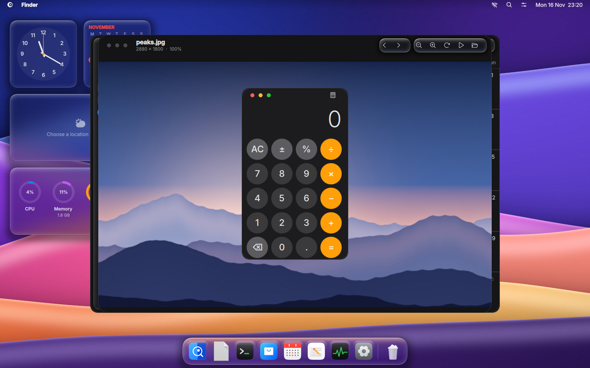

# LUMEN OS

LUMEN OS is a Fedora-based Linux distribution with its own desktop: a
Liquid Glass interface, fluid spring-based motion, a menu bar, a floating
Dock, Control Center, Spotlight, Notification Center, Mission Control and a
suite of native applications. It's inspired by the modern macOS Liquid Glass
design and uses only original artwork, open fonts (Inter, JetBrains Mono)
and its own code.



## What's inside

| Area | Components |
|---|---|
| Design system | `Lumen.Design` (tokens, appearance, typography, symbols), `Lumen.Controls` (25 controls + window chrome) |
| Rendering | `Lumen.Glass`: dual-Kawase blur pyramid + glass composite shader (refraction, dispersion, adaptive tint, specular rim, shadows), 8 materials |
| Motion | `Lumen.Motion`: vsync-driven spring engine, motion tokens, reduced motion |
| Shell | `lumen-shell`: wallpaper & widgets, menu bar (global menus, Window menu), Dock, Control Center, Spotlight, Launchpad, notifications |
| Compositor | KWin 6 + LUMEN decoration, Liquid Glass effect (`lumen_glass`), gestures plugin, window-motion effect, app switcher, defaults |
| Services | `lumend` (Rust search index), NetworkManager, BlueZ, PipeWire, UPower, PowerDevil, AccountsService, firewalld, Flatpak |
| Apps | Finder, System Settings, Terminal, App Store, Activity Monitor, Calculator, Calendar, Text Editor, Image Viewer, Media Player, Screenshot |
| Boot & install | Plymouth theme, SDDM theme, Calamares installer, kiwi live ISO |

## Download

Installable ISO images are built by GitHub Actions
([`.github/workflows/iso.yml`](.github/workflows/iso.yml)) and attached to the
repository's **Releases**. Write the ISO to a USB stick (Fedora Media Writer,
balenaEtcher or `dd`) and boot it on a UEFI PC — or in a VM with UEFI firmware
— then start the installer (Calamares) from the first icon in the Dock.

## Hardware & VM notes

* **Intel / AMD** get full GPU acceleration out of the box (Mesa; VA-API video
  decode included).
* **NVIDIA**: the ISO boots with nouveau; with an RTX/GTX card Control Center
  › Graphics offers **Install NVIDIA Driver** — one click (pkexec) adds RPM
  Fusion and installs `akmod-nvidia`, then a reboot activates it. Secure Boot
  must be off (or a MOK key enrolled); the helper detects and warns.
* **VMs**: use QEMU/KVM with UEFI (`scripts/qemu-boot-test.sh` boots the ISO
  the same way). VirtualBox has no usable Linux GPU acceleration for Wayland.
* Without GPU acceleration LUMEN switches to a **software tier**: plain
  translucent panels replace Liquid Glass so the session stays responsive.
  The tier is shown in Settings › About; `LUMEN_PERF=full|lite|software`
  overrides the probe.

## Building

Everything builds inside a Fedora 45 container that matches the target:

```sh
docker build -t lumen-dev:45 -f scripts/devcontainer/Containerfile scripts/devcontainer   # once (podman: same)
scripts/build.sh                                   # configure, build, run tests
scripts/run-session.sh --compositor sway --shot out.png   # headless session + screenshot
scripts/build-rpms.sh                              # RPMs → out/repo
iso/build-iso.sh                                   # live/installer ISO → out/iso
scripts/qemu-boot-test.sh                          # boot the ISO in QEMU (UEFI/OVMF), save frames
scripts/qemu-glass-test.sh                         # boot the ISO, check compositor glass behind the Dock
```

The ISO is a hybrid BIOS/UEFI image (shim + GRUB, Secure Boot capable) with a
live LUMEN session and the Calamares installer. Fedora packages are
GPG-verified during the build; `out/iso/SHA256SUMS` lists the image checksum.

A short screenshot tour is in [docs/media/lumen-os-tour.mp4](docs/media/lumen-os-tour.mp4).

See [docs/ARCHITECTURE.md](docs/ARCHITECTURE.md), [docs/DESIGN_SYSTEM.md](docs/DESIGN_SYSTEM.md),
[docs/IMPLEMENTATION_PLAN.md](docs/IMPLEMENTATION_PLAN.md) and the evidence-based
[docs/DEVELOPMENT_LOG.md](docs/DEVELOPMENT_LOG.md).

## License

GPL-3.0-or-later for code; CC-BY-SA-4.0 for generated artwork; UI symbols
from Phosphor Icons (MIT). See [LICENSE](LICENSE).
